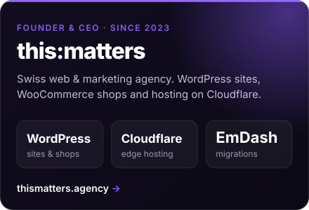
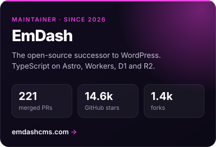

<a href="https://kevinkyburz.ch"></a>

<p align="center">
  <a href="https://kevinkyburz.ch"></a>&nbsp;&nbsp;
  <a href="https://thismatters.agency"></a>&nbsp;&nbsp;
  <a href="https://www.linkedin.com/in/swissky/"></a>&nbsp;&nbsp;
  <a href="https://x.com/swissky"></a>&nbsp;&nbsp;
  <a href="https://bsky.app/profile/swiss.ky"></a>
</p>


I've been writing about tech since 2010 and building on **WordPress** for almost as long. Today I run **[this:matters](https://thismatters.agency)**, a Swiss web & marketing agency for WordPress sites and WooCommerce shops. I also help maintain **[EmDash](https://github.com/emdash-cms/emdash)**, the open-source CMS for Astro and Cloudflare that picks up where WordPress leaves off.

<p align="center">
  <a href="https://thismatters.agency"></a>&nbsp;&nbsp;&nbsp;
  <a href="https://github.com/emdash-cms/emdash"></a>
</p>


<table width="100%">
<tr>
<td width="50%" valign="top">

### ✍️ &nbsp;Latest writing

<!-- blog:start -->
<code>23 Nov</code>&nbsp; <a href="https://kevinkyburz.ch/blog/emdash-cloudflare-waf">Rejected Before It Costs: Cloudflare WAF Rules for EmDash</a><br />
<code>23 Nov</code>&nbsp; <a href="https://kevinkyburz.ch/blog/emdash-1-6">EmDash 1.6: Images Cached for a Year, 404s Without Rendering, P…</a><br />
<code>12 Nov</code>&nbsp; <a href="https://kevinkyburz.ch/blog/emdash-1-5">EmDash 1.5: Real-Time Co-Editing, a Redesigned Block Editor, Na…</a><br />
<code>10 Nov</code>&nbsp; <a href="https://kevinkyburz.ch/blog/emdash-durable-object">Up to ten times faster without a cache: EmDash in a Durable Obj…</a>
<!-- blog:end -->

</td>
<td width="50%" valign="top">

### 🔀 &nbsp;Just merged in EmDash

<!-- prs:start -->
<code>#5032</code>&nbsp; <a href="https://github.com/emdash-cms/emdash/pull/5032">Reuse the date formatter in the blog templates</a><br />
<code>#4994</code>&nbsp; <a href="https://github.com/emdash-cms/emdash/pull/4994">Tag detail-page misses with their collection</a><br />
<code>#4999</code>&nbsp; <a href="https://github.com/emdash-cms/emdash/pull/4999">Drop the stale cron lock write from cold starts</a><br />
<code>#4911</code>&nbsp; <a href="https://github.com/emdash-cms/emdash/pull/4911">Cache media files in the route cache</a>
<!-- prs:end -->

</td>
</tr>
</table>


### The story so far

```diff
  2010   Started my first blog during military service. The domain gave me "@swissky".
  2014   Weekly tech column in Blick am Abend, in print and online, until 2018.
  2016   Launched Travelhackers. Started teaching digital marketing at Digicomp.
  2019   Co-founded Techgarage: independent tech reviews and explainers.
+ 2023   Founded this:matters.
+ 2026   Became an EmDash maintainer.
```

<p align="center">
  
  <br /><br />
  <sub><b>Lauerz, Switzerland</b> · Rooted here. Connected everywhere.</sub>
</p>
