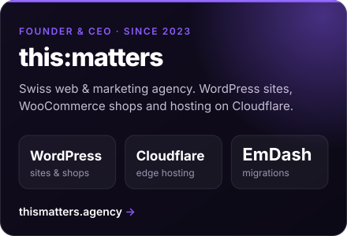
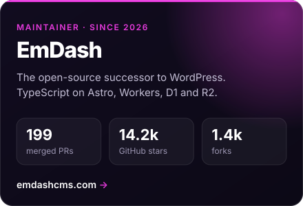

<a href="https://kevinkyburz.ch"></a>

<p align="center">
  <a href="https://kevinkyburz.ch"></a>&nbsp;&nbsp;
  <a href="https://thismatters.agency"></a>&nbsp;&nbsp;
  <a href="https://www.linkedin.com/in/swissky/"></a>&nbsp;&nbsp;
  <a href="https://x.com/swissky"></a>&nbsp;&nbsp;
  <a href="https://bsky.app/profile/swiss.ky"></a>
</p>


I've been writing about tech since 2010 and building on **WordPress** for almost as long. Today I run **[this:matters](https://thismatters.agency)**, a Swiss web & marketing agency for WordPress sites and WooCommerce shops. I also help maintain **[EmDash](https://github.com/emdash-cms/emdash)**, the open-source CMS for Astro and Cloudflare that picks up where WordPress leaves off.

<p align="center">
  <a href="https://thismatters.agency"></a>&nbsp;&nbsp;&nbsp;
  <a href="https://github.com/emdash-cms/emdash"></a>
</p>


<table width="100%">
<tr>
<td width="50%" valign="top">

### ✍️ &nbsp;Latest writing

<!-- blog:start -->
<code>10 Nov</code>&nbsp; <a href="https://kevinkyburz.ch/blog/emdash-durable-object/">Up to ten times faster without a cache: EmDash in a Durable Obj…</a><br />
<code>01 Nov</code>&nbsp; <a href="https://kevinkyburz.ch/blog/emdash-1-4/">EmDash 1.4: a tidier admin and fewer lost edits</a><br />
<code>21 Oct</code>&nbsp; <a href="https://kevinkyburz.ch/blog/emdash-cloudflare-cache/">A cold cache, not a cold start: what really slows EmDash down o…</a><br />
<code>15 Oct</code>&nbsp; <a href="https://kevinkyburz.ch/blog/emdash-1-3/">EmDash 1.3: better for teams, more thorough WordPress imports</a>
<!-- blog:end -->

</td>
<td width="50%" valign="top">

### 🔀 &nbsp;Just merged in EmDash

<!-- prs:start -->
<code>#4696</code>&nbsp; <a href="https://github.com/emdash-cms/emdash/pull/4696">Link blocked embed iframes instead of rendering an empty frame</a><br />
<code>#4694</code>&nbsp; <a href="https://github.com/emdash-cms/emdash/pull/4694">Reject robots.txt settings when the site overrides /robots.txt</a><br />
<code>#4741</code>&nbsp; <a href="https://github.com/emdash-cms/emdash/pull/4741">Read plugin KV from options in the crash-recovery test</a><br />
<code>#4697</code>&nbsp; <a href="https://github.com/emdash-cms/emdash/pull/4697">Match slug-change redirects with or without a trailing slash</a>
<!-- prs:end -->

</td>
</tr>
</table>


### The story so far

```diff
  2010   Started my first blog during military service. The domain gave me "@swissky".
  2014   Weekly tech column in Blick am Abend, in print and online, until 2018.
  2016   Launched Travelhackers. Started teaching digital marketing at Digicomp.
  2019   Co-founded Techgarage: independent tech reviews and explainers.
+ 2023   Founded this:matters.
+ 2026   Became an EmDash maintainer.
```

<p align="center">
  
  <br /><br />
  <sub><b>Lauerz, Switzerland</b> · Rooted here. Connected everywhere.</sub>
</p>
